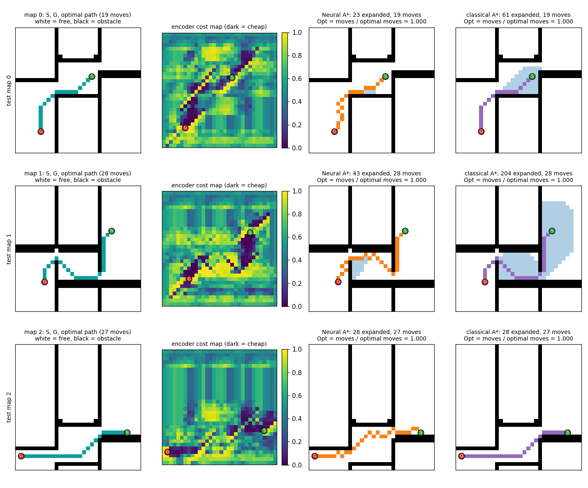
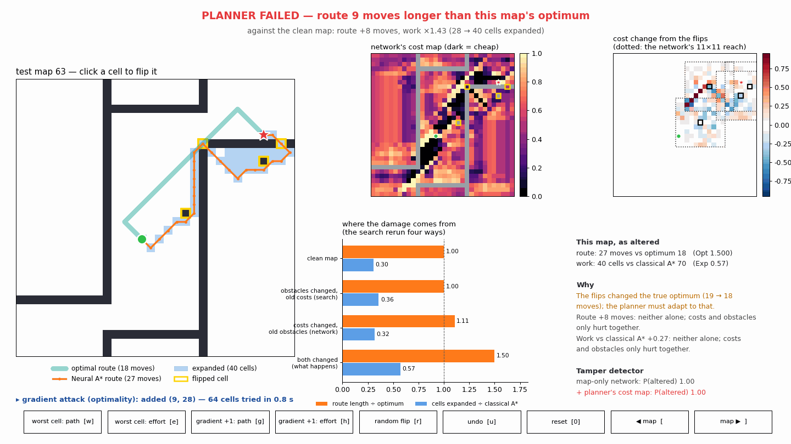

# How do small changes in a map affect a learned path planner?

Interpretability and robustness study of **Neural A\*** (Yonetani et al., ICML 2021).
AI Interpretability course project, PPGC/UFRGS, 2026/2.

> *Como pequenas mudanças em um mapa afetam um planejador de rotas aprendido?*

## The setup in one paragraph

Neural A\* has two stages. A convolutional **encoder** (the only learned part) reads
an obstacle map plus start and goal and outputs a per-cell **cost map**. A fixed,
differentiable **A\*** then searches on that cost map. Because the search takes the
cost map and the obstacle mask as separate inputs, we can run it on all four
combinations of {original, altered} costs × {original, altered} obstacles after
flipping 1–8 cells, and measure how much of the damage each route reproduces:

|                    | original obstacles      | altered obstacles         |
|--------------------|-------------------------|---------------------------|
| **original costs** | `C0O0` baseline         | `C0O1` search route only  |
| **altered costs**  | `C1O0` encoder route only | `C1O1` full alteration  |

Classical A\* on the altered map is the ground truth: replanning because the map
changed is not an error; deviating from the *altered* map's optimum is.



## Status — 2026-11-21

| | state |
|---|---|
| Experiments (plan steps 0–13) | **All done.** Mazes (4 models), forest (3 models), WarCraft (3 models), detector, gradient and adaptive attacks. |
| Reproducibility | Pinned env, `make` target per step, 16-file test suite, `make verify` checks quoted numbers against stored results. |
| **Open** | Final write-up (course deliverable). Team names below are still placeholders. |
| Optional, not started | Joint two-cell adaptive attack; WarCraft with random start/goal (tests the position shortcut); 64×64 map families. |

Reproduction (100 test mazes): Opt 84.0 %, Exp 43.5 %, Hmean 57.3 %, against the
paper's 87.7 / 40.1 / 52.0 (the paper pools eight map types; checkpoint is the one
shipped upstream).

## Results against the hypothesis

**Hypothesis (as proposed).** The cost map is a smoothed version of distance-to-goal
and proximity-to-obstacles (H1). A flip distorts it locally; *large* distortions
steer the search to a worse path (encoder-mediated), *small* ones only break ties
and inflate expansions (search-mediated), so each kind of damage has a dominant
route (H2). Competing hypothesis: the cost map is a path-prediction map.

| claim | verdict | evidence |
|---|---|---|
| H1: cost map ≈ smoothed geometric heuristic | **Refuted as stated**, partly in substance | Linear R² 0.026 on goal + obstacle features; the search's own heuristic 0.002. Non-linear 0.24. |
| Competing: cost map ≈ path prediction | **Partial** | Path indicators alone R² 0.12 (mazes), 0.035 (forest). All features together 0.41; ~59 % explained by nothing we named. |
| Neural A\* is fragile to small changes | **Confirmed, but thin** | 86 % of optimal maps have ≥ 1 damaging single flip; only a median 0.78 % of cells are damaging, so random flips hit ~1 %. |
| Path-quality damage is encoder-mediated | **Confirmed** | 7/7 models, two families. Mazes: encoder 0.46–0.63 vs search 0.28–0.44, non-overlapping. |
| Search-effort damage is search-mediated | **Confirmed on mazes, undetermined on forest** | Mazes (4/4): search 0.26–0.36 vs encoder 0.04–0.23. Forest: 2 seeds lean encoder by 0.03–0.07, 1 leans search by 0.34. |
| Mechanism: distortion *size* decides the damage | **Refuted** | Correlation of distortion size with damage +0.04 over 102 198 flips; −0.06 among damaged cases. Location predicts damage (6.2 % on-route open space vs 1.1 % off-route by a wall). |
| H2 falsifier: damage is mostly interaction | **Not triggered at k = 1, grows with budget** | Interaction 24 % at k = 1, 45 % at k = 8; dominant route flips from encoder (k = 1) to search (k = 8). |

**Net reading.** The route split predicted by H2 holds, but not for the reason the
hypothesis gave: what the encoder encodes is not a smoothed heuristic, and how much
it is distorted does not explain the damage. Where the flipped cell sits does.

### Other findings

- **A surrogate beats the network on path quality.** Feeding the search a ridge/boosting
  surrogate (R² 0.41) gives 92 % optimal vs the network's 83 %, at slightly more search
  effort. On forest it is better on both axes (81 % vs 54 % optimal).
- **Grad-CAM fails an exact test.** The receptive field is exactly 11×11; integrated
  gradients and saliency put 100 % of their mass inside it, Grad-CAM 10.9 %.
- **Seeds.** Aggregate findings replicate across models; cost maps agree at only
  r ≈ 0.79–0.88 and vulnerable cells overlap ~half the time.
- **WarCraft (terrain images).** The cost map encodes mostly *position* (R² 0.62–0.69),
  not terrain (0.04–0.05), although terrain is linearly readable one layer earlier
  (R² 0.91). 82–85 % of damage is cost-ranking error; a 1/255 PGD step breaks 84–85 %
  of optimal maps.
- **Tamper detection (E4).** The cost-map residual adds +0.08 to +0.12 AUC over a CNN
  reading the raw grid, but only for single-cell, effort-targeted flips on mazes (4/4
  models). Path objective, k ≥ 2 and forest: nothing. As a standalone detector it loses
  to a Mahalanobis baseline in all ten conditions.
- **Attacks.** A gradient-ranked attack (no oracle) breaks 94 % of optimal maps at k = 8,
  vs 86 % for the sweep-seeded greedy. An adaptive attacker with one camouflage cell
  erases the detector's gain on 1 of 4 models.

### Premises corrected by measurement

- Moves cost 1, diagonals included (not √2).
- The maps are thin walls between ~10-cell-wide rooms, not width-1 corridors; no single
  flip disconnects the goal.
- The encoder has five 3×3 convolutions (radius 5), not four.
- Mediation on effort was read three ways before replication settled it: from one model,
  a 0.03 margin is not a direction.

Per-step reports with every number: `results/*.md`.

## Setup

Python 3.10, CPU only.

```bash
git clone --recursive https://github.com/JoaoPedroFPK/inside-neural-astar.git
cd inside-neural-astar
make env                      # builds .venv from pinned deps and asserts it
source .venv/bin/activate
make test
```

Data and the pretrained maze checkpoint ship in the `neural-astar` submodule
(never edited). WarCraft: `make warcraft-data` (0.9 GB, CC BY 4.0).

## Running

| target | what | time (laptop CPU) |
|---|---|---|
| `make pipeline` | steps 0–9 in order, then `verify` | ~1 h 15 |
| `make e0` / `step2` | reproduction / exact-solver validation | seconds |
| `make sweep` / `swap` | exhaustive single-cell flips / 2×2 mediation | ~20 min / ~10 s |
| `make budgets` | greedy k ≤ 8 and mediation vs budget | — |
| `make train`, `seed-pipeline TAG=…`, `seeds` | extra encoders and their replication | ~30 min per model |
| `make warcraft-train`, `warcraft` | WarCraft study | ~3 h + ~45 min per model |
| `make detector` / `gradient` / `adaptive` | detection and attacks | ~2 / ~45 / ~30 min |
| `make demo` | interactive browser demo (`MAP=63`, `DETECTOR=1`, `WARCRAFT=1`) | — |
| `make help` | every target | — |

Every script seeds numpy and torch and accepts `--seed`.



## Metrics

- **Opt ratio**: planner path cost ÷ optimal cost on the same (altered) map; 1.0 = optimal.
- **Exp ratio**: planner expansions ÷ classical A\* expansions on the same map.
- **Mediation fraction**: `(M[C1O0] − M[C0O0]) / (M[C1O1] − M[C0O0])` for the encoder
  route, `C0O1` for the search route. Both reported; they need not sum to 1.
- The paper's binary Opt / floored Exp / Hmean are kept in `src/metrics.py` for the
  reproduction only.

## Layout

```
neural-astar/   upstream submodule (minimal branch, untouched)
src/            planner wrapper, exact solver, metrics, features, surrogate,
                perturbations, swap harness, attribution, detector, WarCraft
scripts/        one script per experiment (see Makefile)
tests/          unit and guard tests
results/        versioned .md/.json reports; .npz/.parquet/models are regenerated
figures/        README figures (make figures)
```

## Team

Group *<group name>* — <member 1>, <member 2>, <member 3>.

## References

- Yonetani, R. et al. (2021). *Path Planning using Neural A\* Search.* ICML. [arXiv:2009.07476](https://arxiv.org/abs/2009.07476) · [code](https://github.com/omron-sinicx/neural-astar)
- Bhatt, S. et al. (2022). *[Reproducibility Report] Path Planning using Neural A\* Search.* [arXiv:2208.04153](https://arxiv.org/abs/2208.04153)
- Vlastelica, M. et al. (2020). *Differentiation of Blackbox Combinatorial Solvers.* ICLR. [arXiv:1912.02175](https://arxiv.org/abs/1912.02175)
- Tamar, A. et al. (2016). *Value Iteration Networks.* NeurIPS. [arXiv:1602.02867](https://arxiv.org/abs/1602.02867)
- Lee, L. et al. (2018). *Gated Path Planning Networks.* ICML. [arXiv:1806.06408](https://arxiv.org/abs/1806.06408)
- Zeng, W. et al. (2019). *End-to-end Interpretable Neural Motion Planner.* CVPR. [arXiv:2101.06679](https://arxiv.org/abs/2101.06679)
- Wang, Y. et al. (2018). *A Training-based Identification Approach to VIN Adversarial Examples.* [arXiv:1810.08070](https://arxiv.org/abs/1810.08070)
- Szvoren, A. et al. (2025). *Exploring Adversarial Obstacle Attacks in Search-based Path Planning for Autonomous Mobile Robots.* [arXiv:2504.06154](https://arxiv.org/abs/2504.06154)
- Geisler, S. et al. (2022). *Generalization of Neural Combinatorial Solvers Through the Lens of Adversarial Robustness.* ICLR. [arXiv:2110.10942](https://arxiv.org/abs/2110.10942)
- Ilyas, A. et al. (2019). *Adversarial Examples Are Not Bugs, They Are Features.* NeurIPS. [arXiv:1905.02175](https://arxiv.org/abs/1905.02175)
- Sundararajan, M. et al. (2017). *Axiomatic Attribution for Deep Networks.* ICML. [arXiv:1703.01365](https://arxiv.org/abs/1703.01365)
- Selvaraju, R. et al. (2017). *Grad-CAM.* ICCV. [arXiv:1610.02391](https://arxiv.org/abs/1610.02391)
- Adebayo, J. et al. (2018). *Sanity Checks for Saliency Maps.* NeurIPS. [arXiv:1810.03292](https://arxiv.org/abs/1810.03292)
- Alain, G.; Bengio, Y. (2016). *Understanding intermediate layers using linear classifier probes.* [arXiv:1610.01644](https://arxiv.org/abs/1610.01644)
- Vig, J. et al. (2020). *Investigating Gender Bias in Language Models Using Causal Mediation Analysis.* NeurIPS. [arXiv:2004.12265](https://arxiv.org/abs/2004.12265)
- Heimersheim, S.; Nanda, N. (2024). *How to use and interpret activation patching.* [arXiv:2404.15255](https://arxiv.org/abs/2404.15255)
- Lee, K. et al. (2018). *A Simple Unified Framework for Detecting Out-of-Distribution Samples and Adversarial Attacks.* NeurIPS. [arXiv:1807.03888](https://arxiv.org/abs/1807.03888)
- Molnar, C. (2022). *Interpretable Machine Learning*, 2nd ed. [online](https://christophm.github.io/interpretable-ml-book/)

## License

Code: MIT (see `LICENSE`). The Neural A\* submodule keeps its own license.
